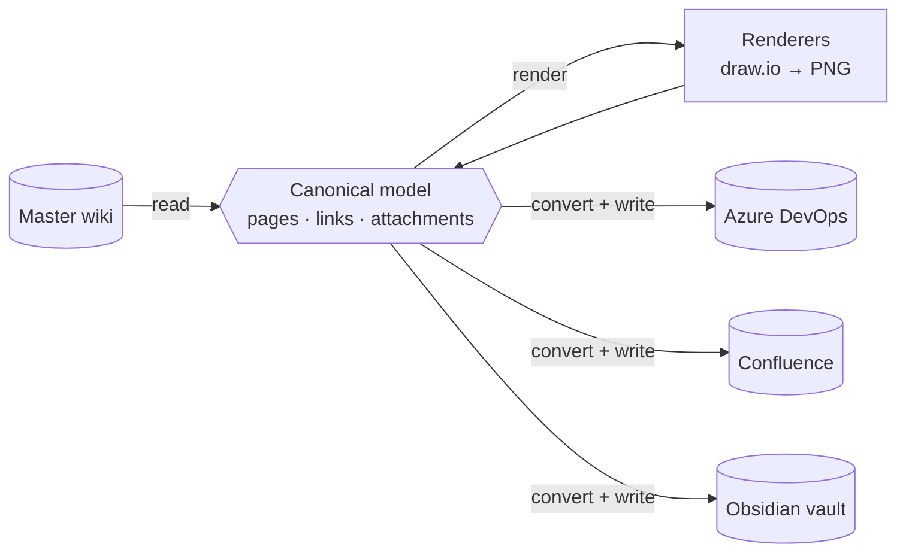

<div align="center">


# Tolarix

**One wiki to write in. Every wiki stays up to date.**

Tolarix mirrors your Master wiki into Azure DevOps, Confluence and Obsidian —<br/>
links, images and attachments included — on a schedule or with one click.

[](https://github.com/davidemaggi/Tolarix/actions/workflows/ci.yml)
[](LICENSE)


[Why](#-why-tolarix) · [Features](#-features) · [Install](#-install) · [Docs](#-documentation) · [Formats](#-supported-wikis) · [Roadmap](#-roadmap) · [Build](#-build-from-source)

</div>

---

## 💡 Why Tolarix?

Your engineers live in Azure DevOps. Your business lives in Confluence. You take
notes in Obsidian. The same documentation ends up copied by hand into three
places, and two of them are always out of date.

Tolarix fixes that with a simple rule: **one wiki is the Master, the others are
Mirrors.** Write once, and Tolarix keeps every Mirror in step: same pages, same
hierarchy, working links, attachments and diagrams, converted to each wiki's own
format.

## ✨ Features

- 🔁 **One-way, predictable sync.** Master → Mirrors, never the other way. No merge conflicts, no surprises.
- 🧭 **Format-aware conversion.** Callouts, Mermaid, code blocks, tables and task lists are translated to each wiki's dialect. Anything a target can't show degrades gracefully, and the run report says so.
- 🔗 **Links that keep working.** Internal links and images are rewritten for every mirror, so nothing points back to the Master by accident.
- 🧩 **Sync it all, or just a branch.** Pick whole spaces or individual subtrees from a tree with checkboxes.
- 🕵️ **Smart and incremental.** Content hashes and a mapping table mean only changed pages are touched, and renames are real moves rather than delete + create.
- 🧪 **Dry-run first.** See exactly what would be created, updated, moved or deleted before anything is written.
- 🗓️ **Schedules for humans.** "Every weekday at 07:30, Europe/Rome", not `30 7 * * 1-5`. Advanced cron is there if you want it.
- 📐 **draw.io aware.** Diagrams stay editable as `.drawio` attachments *and* show up as PNGs in the mirror.
- 🛡️ **Secure by default.** Encrypted secrets at rest (AES-256-GCM), nothing sensitive in logs or API responses, a single admin account with forced first-login password change.
- 🌍 **English and Italian UI**, light and dark themes, keyboard-friendly and accessible.

## 🧱 One core, three ways to run it

| | |
|---|---|
| 🐳 **Docker** | A web app for your team: one container, one volume, an admin login. |
| 🖥️ **Desktop** | A native app for Windows, macOS and Linux (Tauri). No server to run. |
| ⌨️ **CLI** | `tolarix flow run docs --dry-run`, for scripts, cron and Windows Task Scheduler, with meaningful exit codes and `--json` output. |

All three are the same single Go binary sharing the same SQLite database.

## 📦 Install

**Docker** (a team server with the web interface):

```sh
docker run -d --name tolarix -p 8080:8080 -v tolarix-data:/data ghcr.io/davidemaggi/tolarix:1
docker logs tolarix        # the one-time admin password
```

Then open http://localhost:8080. Compose file, HTTPS, backups and upgrades: [admin guide](docs/admin-guide.md).

**Desktop app**: download the installer for Windows, macOS or Linux from the
[releases page](https://github.com/davidemaggi/Tolarix/releases).

> [!NOTE]
> The v1 installers are not signed. On macOS, open the app the first time with
> right-click → **Open**. On Windows, choose **More info → Run anyway** in SmartScreen.

**Command line**: download the `tolarix` archive for your platform from the same
page, check it against `SHA256SUMS`, and put the binary on your PATH.

## 📖 Documentation

| Guide | For |
|---|---|
| [User guide](docs/user-guide.md) · [Guida utente (italiano)](docs/it/guida-utente.md) | connecting wikis, flows, schedules, run reports, conversion limits, CLI |
| [Admin guide](docs/admin-guide.md) | Docker, first sign-in, password reset, secret key, backup, upgrades, HTTPS |
| [Scheduling](docs/scheduling.md) | cron, systemd, launchd, Windows Task Scheduler, Docker, Kubernetes |
| [Developer guide](docs/dev/README.md) | architecture, setup, tests, adding a connector, releasing |
| [Changelog](CHANGELOG.md) | what changed in each version |

## ⚙️ How it works



Every connector translates to and from one **canonical model**: a tree of pages
in CommonMark + GFM, with links expressed as stable page references. Adding a
new wiki means writing one connector; the sync engine doesn't change.

## 📚 Supported wikis

| Wiki | As Master | As Mirror | Status |
|---|:---:|:---:|---|
| Obsidian vault | ✅ | ✅ | ✅ works |
| Confluence Data Center / Server | ✅ | ✅ | ✅ works (M4) |
| Azure DevOps — Code wiki | ✅ | ✅ | ✅ works (M4) |
| Confluence Cloud | ✅ | ✅ | ✅ works (M5) |
| Azure DevOps — Project wiki | ✅ | ✅ | ✅ works (M5) |

## 🗺️ Roadmap

- [x] **M1 · Foundations.** Single binary, SQLite with migrations, encrypted secrets, web shell (i18n, themes), CI
- [x] **M2 · Sync engine + Obsidian.** Canonical model, incremental sync, moves, delete policies, dry-run, CLI
- [x] **M3 · Web app + Docker.** Admin login, guided wizards, dashboard, live run logs
- [x] **M4 · Priority connectors.** Confluence Data Center / Server and Azure DevOps Code wiki, draw.io → PNG
- [x] **M5 · More connectors.** Confluence Cloud and Azure DevOps Project wiki
- [x] **M6 · Scheduling.** Built-in scheduler, human-friendly schedule wizard, `run-due` for external schedulers
- [x] **M7 · Desktop app.** Installers for Windows, macOS and Linux
- [x] **M8 · v1.0.** Docs, hardening, accessibility pass, release (in review)

Details and decisions: [docs/dev/plan.md](docs/dev/plan.md).

## 🚀 Build from source

You'll need Go 1.27+, Node.js 22+ and pnpm.

```sh
git clone https://github.com/davidemaggi/Tolarix.git
cd Tolarix
pnpm install
pnpm build                               # web UI + ./bin/tolarix
./bin/tolarix serve --data-dir ./data    # → http://localhost:8080
```

### Try it from the command line: mirror one Obsidian vault into another

```sh
# Describe your vaults and the flow (see docs/examples/flows.example.yaml)
./bin/tolarix flow import my-flows.yaml

./bin/tolarix flow run "Notes to team" --dry-run   # see what would change
./bin/tolarix flow run "Notes to team"             # do it
./bin/tolarix runs show <run-id>                   # what changed, warnings included
```

Run it again and only what changed in the Master is touched: renames become
moves, removed pages are archived, and edits made by hand on the mirror are
overwritten, each one reported.

The developer guide is in [docs/dev/README.md](docs/dev/README.md).

## 🤝 Contributing

Ideas, bug reports and pull requests are welcome. If you're planning
something big, such as a new wiki connector, open an issue first so we can
agree on the shape. Start with the [developer guide](docs/dev/README.md).

## 📄 License

Tolarix is free software under the [GNU GPL v3](LICENSE).
