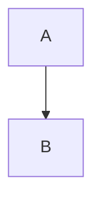

# Intro

Plain **bold**, *italic*, ~~gone~~, `a|b` and \*escaped\* &amp; <u>html</u> <br> done.
Soft break here\
hard break.

<!-- tolarix:toc -->

## Next Steps

- one
- two
  - nested [link](https://example.com)
- [x] not a task list item in mixed list

3. three
4. four

- [x] done
- [ ] open

> plain quote

> [!warning] Careful
> Body line
>
> - list in callout

> [!faq]- Folded
> hidden

```js
const a = "<b>]]>";
```



```confluence-macro
<ac:structured-macro ac:name="gadget"><ac:parameter ac:name="url">x</ac:parameter></ac:structured-macro>
```

<div>raw block</div>

---

| Name | Value |
| --- | --- |
| a | b<br>c |

|  |  |
| --- | --- |
| no | header |
