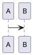

Water is H2O, area is r2.

<!-- tolarix:excerpt -->

The short version.

- with a list

<!-- tolarix:excerpt-end -->

<table>
<tr><th>Step</th><th>Details</th></tr>
<tr><td colspan="2">Prepare &amp; check</td></tr>
<tr><td>Run</td><td><ul><li>first <a href="tolarix://page/100#Intro">intro</a></li><li>then <a href="tolarix://page/200"><strong>Backend</strong> Guide</a> or <a href="https://example.com">out</a></li></ul></td></tr>
<tr><td>Code</td><td><pre><code class="language-go">a := 1&#10;&#10;b := 2</code></pre></td></tr>
<tr><td>Pic</td><td>

x1 <del>old</del>
</td></tr>
</table>
