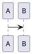
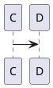
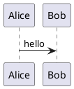

Ask @Ada Lovelace or @ff8080. H<sub>2</sub>O and x<sup>2</sup>.

@Ada Lovelace







```confluence-macro
<ac:structured-macro ac:name="plantumlcloud"><ac:parameter ac:name="data">!!!</ac:parameter></ac:structured-macro>
```


\[diagram: lost\]

[spec.pdf](tolarix://att/bbbb000000000000000000000000000000000000000000000000000000000002)


Elsewhere

<!-- tolarix:excerpt -->

The short version.

<!-- tolarix:excerpt-end -->

\
*The **big** picture*

<table>
<tr><th>Step</th><th>Details</th></tr>
<tr><td colspan="2">Prepare &amp; check</td></tr>
<tr><td>Run</td><td><ul><li>first <a href="tolarix://page/100#Intro">intro</a></li><li>then <a href="tolarix://page/200">Backend Guide</a></li></ul></td></tr>
<tr><td>Code</td><td><pre><code class="language-go">a := 1&#10;&#10;b := 2</code></pre></td></tr>
<tr><td>Pic</td><td><p></p><p>x<sub>1</sub></p></td></tr>
</table>
<!-- warnings: diagram-missing link-outside-master macro-unsupported table-html -->
