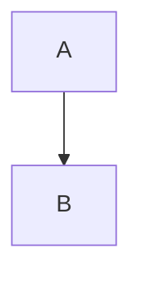

<!-- tolarix:toc -->

````csharp
var x = "<b>";
// ``` fence inside
````

```
raw text
```

> [!info] Heads up
> Info body
>
> - item

> [!warning]
> Yellow

> [!danger]
> Red

> [!tip]
> Green

> [!note]- More
> Hidden

Status \[DONE\] and ABC-1.


Before

```confluence-macro
<ac:structured-macro ac:name="gadget"><ac:parameter ac:name="url">x</ac:parameter></ac:structured-macro>
```

after

Kept body



- [x] done thing
- [ ] open thing
<!-- warnings: macro-unsupported -->
