# Manuale di Tolarix: una visita guidata

Questo manuale accompagna in Tolarix dal primo accesso al primo resoconto di
un'esecuzione, una schermata alla volta. Segue un solo esempio: un team tiene
il proprio manuale tecnico in un vault Obsidian (il **Master**) e ne vuole una
copia in altri tre posti (i **Mirror**):

- un secondo vault per il sito pubblico;
- una cartella Markdown per un generatore di siti statici;
- una wiki GitHub.

Le schermate sono le stesse nell'app web in Docker e nell'app desktop. Ogni
campo è spiegato nella [guida utente](guida-utente.md), il riferimento da tenere
a portata di mano. Questo manuale esiste anche in inglese:
[../manual.md](../manual.md).

1. [Accedere](#1-accedere)
2. [Collegare le wiki](#2-collegare-le-wiki)
3. [Creare un flusso](#3-creare-un-flusso)
4. [Eseguirlo e leggere il resoconto](#4-eseguirlo-e-leggere-il-resoconto)
5. [Nell'uso quotidiano](#5-nelluso-quotidiano)

## 1. Accedere

> L'app desktop non chiede di accedere: passa al [punto 2](#2-collegare-le-wiki).

Su un server nuovo, Tolarix scrive una **password monouso** nel suo log
(`docker logs tolarix`). Apri l'indirizzo web, inserisci quella password e accedi.

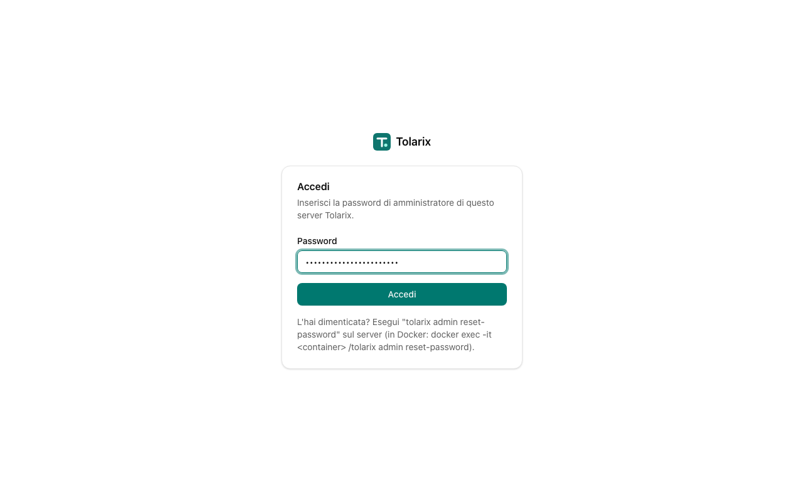

Poi Tolarix chiede di scegliere una password personale, lunga almeno 12
caratteri. Finché non lo fai non funziona nient'altro. La
[guida per l'amministratore](../admin-guide.md#resetting-the-admin-password)
(in inglese) spiega come reimpostare una password dimenticata.

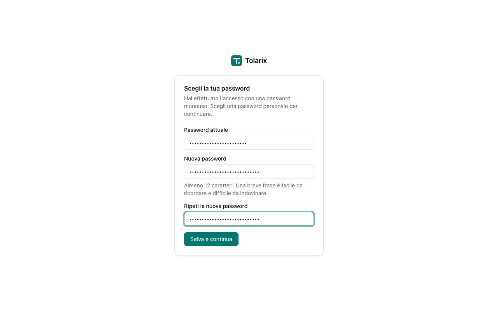

Si arriva alla **Panoramica**. Per ora è vuota: mostrerà ogni flusso e com'è
andata la sua ultima esecuzione.

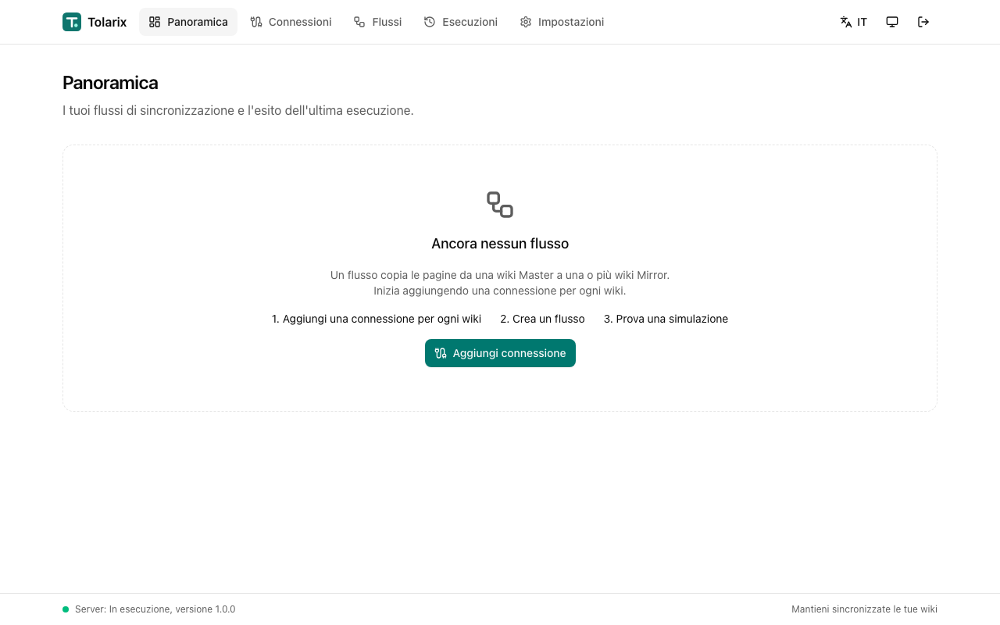

## 2. Collegare le wiki

Una **connessione** dice a Tolarix come raggiungere una wiki. Apri
**Connessioni** → **Aggiungi connessione** e scegli il tipo di wiki. Ogni scheda
indica se quel tipo può fare da Master, da Mirror o da entrambi. Le cartelle
locali possono essere solo Mirror.

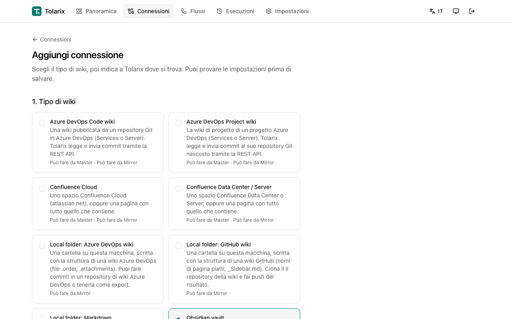

Dai alla connessione un nome che riconoscerai, poi compila i dettagli di quel
tipo: qui, la cartella del vault. Per Azure DevOps e Confluence servono
l'indirizzo copiato dal browser e un token. **Prova connessione** verifica le
impostazioni prima di salvarle. Token e password vengono salvati cifrati e non
vengono più mostrati.

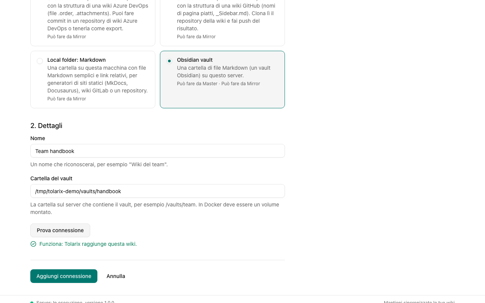

Aggiungi una connessione per ogni wiki. Nell'esempio sono quattro: il vault
Master, il vault pubblico e due cartelle di esportazione. Le connessioni ad
Azure DevOps e Confluence si aggiungono allo stesso modo. Una connessione può
essere usata da tutti i flussi che vuoi.

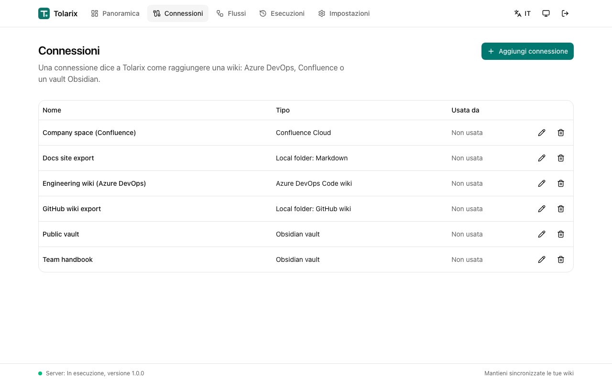

I dettagli di ogni tipo di wiki (indirizzi, token, permessi) sono in
[guida utente → Collegare le wiki](guida-utente.md#collegare-le-wiki).

## 3. Creare un flusso

Un **flusso** dice cosa copiare, da quale Master, verso quali Mirror e quando.
Apri **Flussi** → **Nuovo flusso**. La procedura ha sei passi; l'elenco a
sinistra mostra a che punto sei, e puoi tornare indietro in qualsiasi momento.

**Master.** Dai un nome al flusso e scegli la wiki Master. Tolarix legge
soltanto il Master, non ci scrive mai.

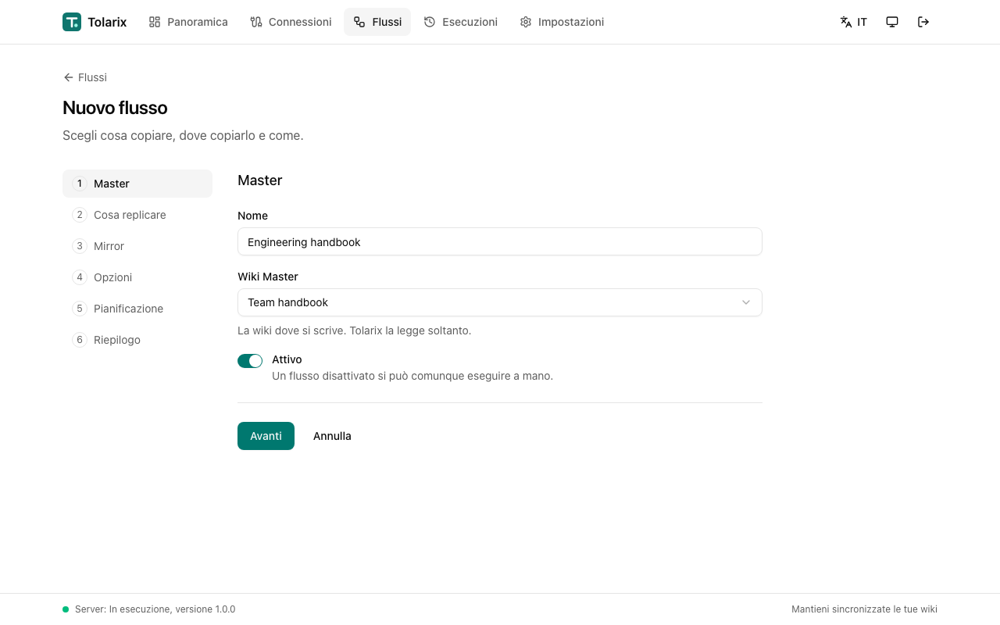

**Cosa replicare.** Copia tutta la wiki togliendo la spunta a ciò che vuoi
escludere, oppure spunta solo le pagine e le cartelle che ti servono. Qui la
cartella *Drafts* resta esclusa.

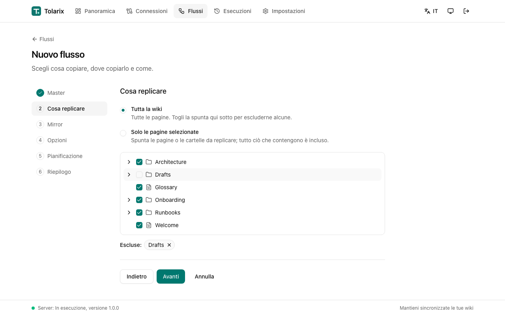

**Mirror.** Aggiungi uno o più Mirror. Per ognuno puoi scegliere una cartella al
suo interno, così le pagine copiate non si mescolano a quelle già presenti. Qui
il vault pubblico riceve le pagine sotto *Handbook* e l'esportazione per il sito
sotto *docs*; la wiki GitHub le riceve al primo livello.

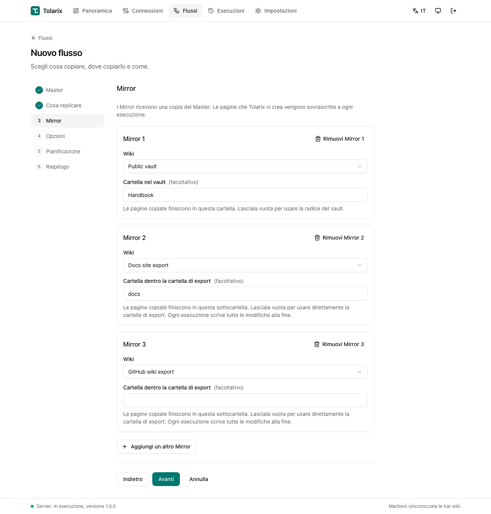

**Opzioni.** Scegli cosa succede nei Mirror quando una pagina viene rimossa dal
Master: archiviarla (il valore predefinito, così non si perde nulla),
eliminarla o lasciarla. Puoi anche scegliere se copiare gli allegati e se
aggiungere in cima a ogni pagina copiata un avviso che invita a modificare il
Master.

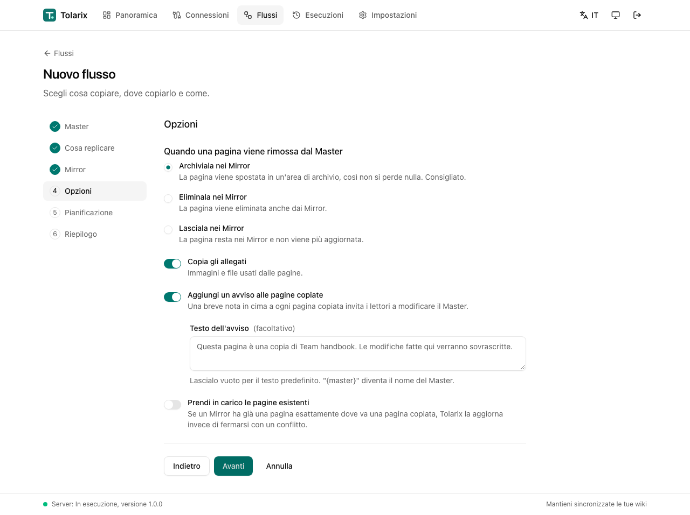

**Pianificazione.** Scegli quando parte il flusso: solo a mano, ogni tot minuti
o ore, ogni giorno, in alcuni giorni della settimana o una volta al mese.
L'anteprima mostra le prossime esecuzioni, così puoi controllare prima di
salvare. **Avanzata** accetta un'espressione cron. Qui parte ogni giorno feriale
alle 07:30.

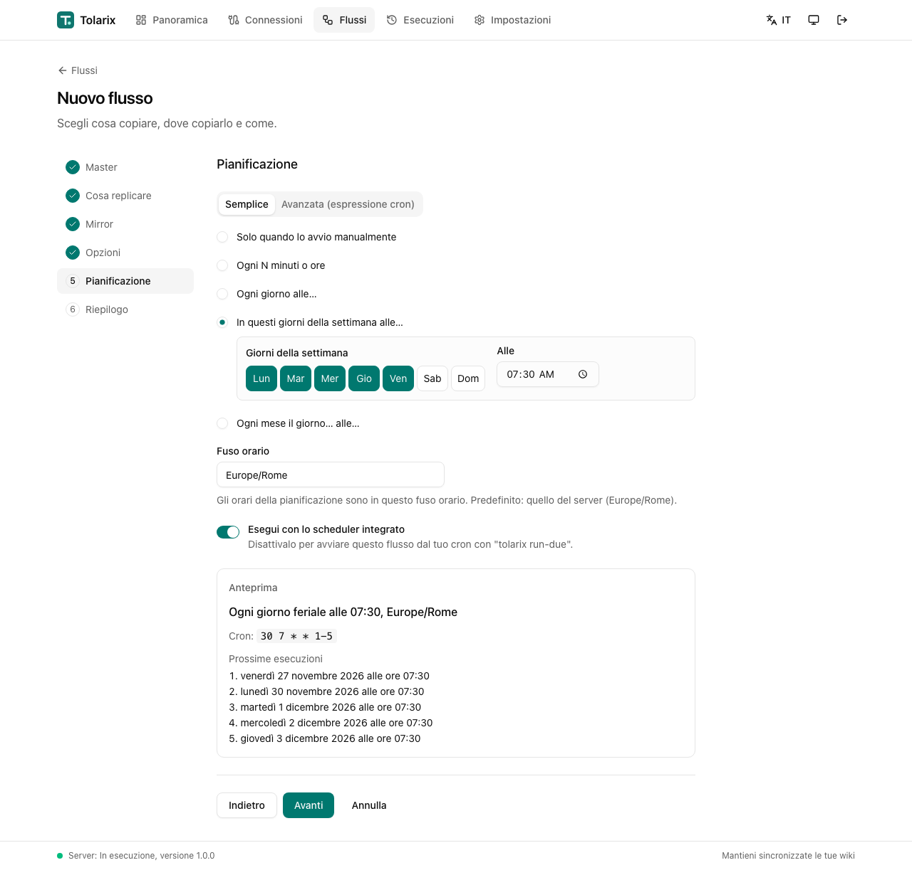

**Riepilogo.** Controlla tutto e usa **Modifica** per tornare a un passo.
**Crea flusso** lo salva.

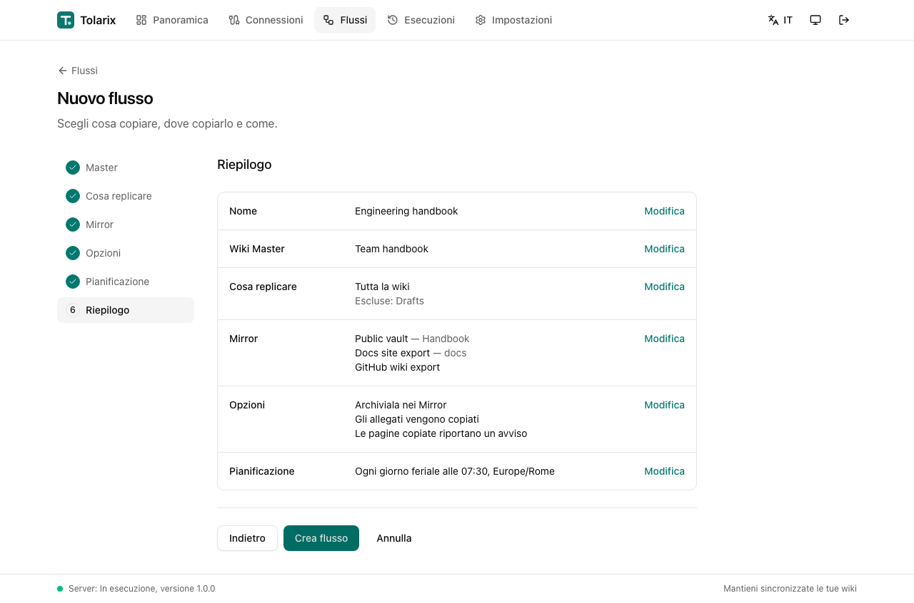

## 4. Eseguirlo e leggere il resoconto

Nella pagina del flusso, **Simulazione** mostra cosa cambierebbe un'esecuzione
senza cambiare nulla: conviene farla prima della prima esecuzione vera.
**Esegui ora** avvia l'esecuzione. La pagina dell'esecuzione mostra i totali e
segue il log in diretta. Puoi lasciare la pagina: l'esecuzione prosegue sul
server.

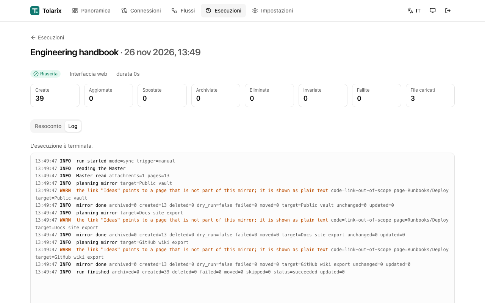

La scheda **Resoconto** elenca, per ogni Mirror, ogni pagina creata, aggiornata,
spostata, archiviata o eliminata, e dove è finita. **Avvisi** elenca ciò che non
è stato possibile copiare in modo identico. Qui il runbook *Deploy* contiene un
link a una pagina di *Drafts*, che il flusso esclude, quindi nei Mirror quel
link compare come testo semplice. Ogni codice di avviso è spiegato nella
[guida utente](guida-utente.md#leggere-il-resoconto-di-unesecuzione).

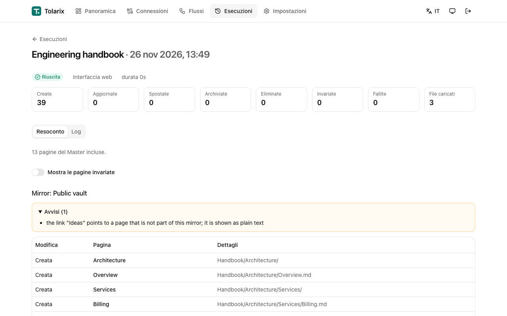

Le esecuzioni sono incrementali: la successiva tocca solo ciò che è cambiato nel
Master. Dopo una modifica alla pagina *Deploy*, la seconda esecuzione ha
aggiornato solo quella pagina in ogni Mirror ("3 aggiornate"). La pagina del
flusso mostra la pianificazione, la prossima esecuzione e le esecuzioni recenti.

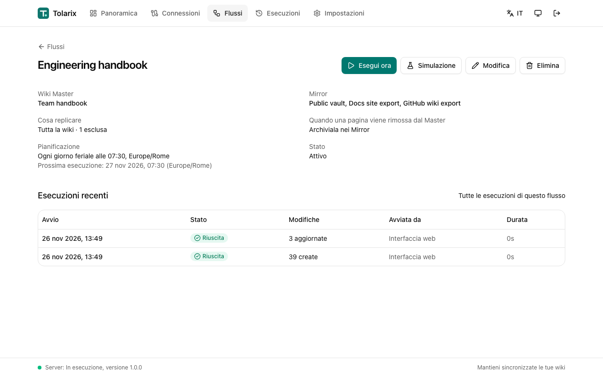

## 5. Nell'uso quotidiano

La **Panoramica** mostra ogni flusso, com'è andata la sua ultima esecuzione e i
pulsanti **Esegui ora** e **Simulazione**. Qui un secondo flusso copia solo le
pagine di onboarding e finora è stato provato con una simulazione.

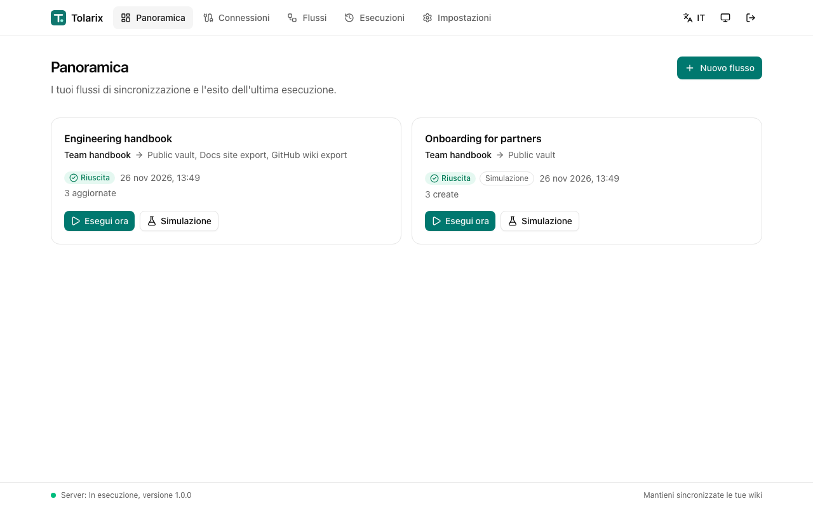

**Esecuzioni** elenca tutte le esecuzioni e le simulazioni, dalla più recente,
con filtri per flusso, stato e tipo.

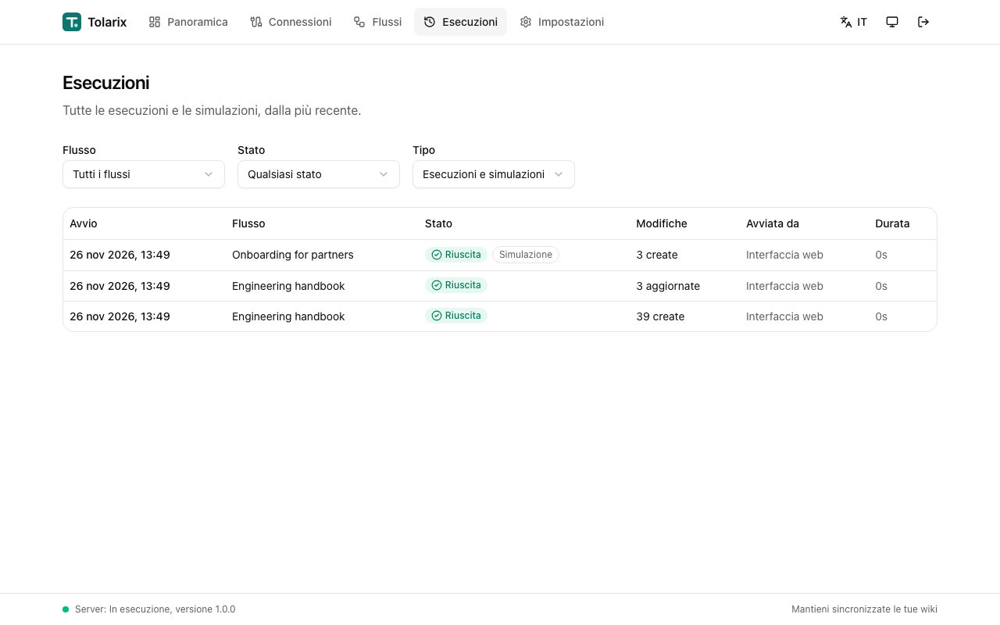

Il menu del tema in alto passa da chiaro a scuro o all'impostazione di sistema,
e il menu della lingua passa dall'italiano all'inglese.

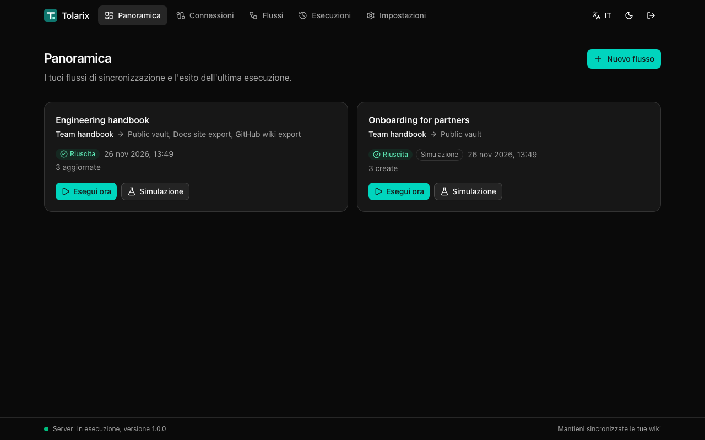

### Per approfondire

- [Guida utente](guida-utente.md): ogni opzione, i limiti di conversione di ogni
  wiki, la riga di comando e le domande frequenti.
- [Scheduling](../scheduling.md) (in inglese): avviare i flussi da cron,
  systemd, launchd o Utilità di pianificazione di Windows invece che dallo
  scheduler integrato.
- [Admin guide](../admin-guide.md) (in inglese): installazione con Docker,
  backup, aggiornamenti e HTTPS.
